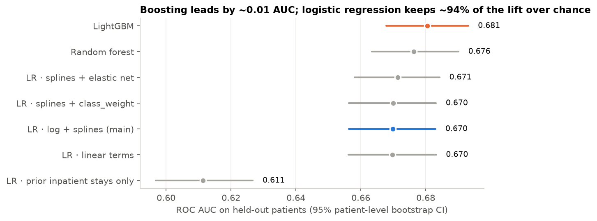
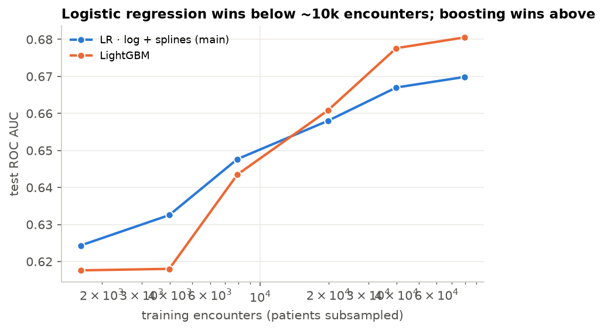
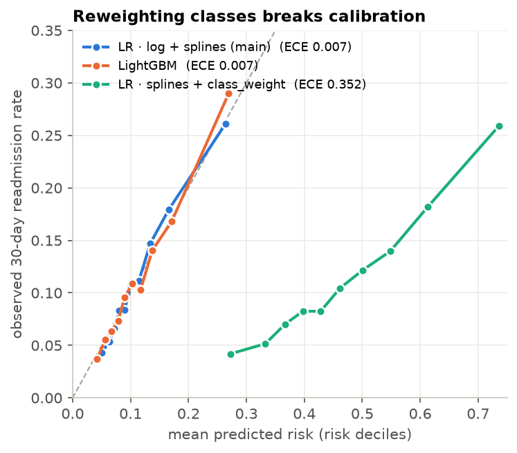
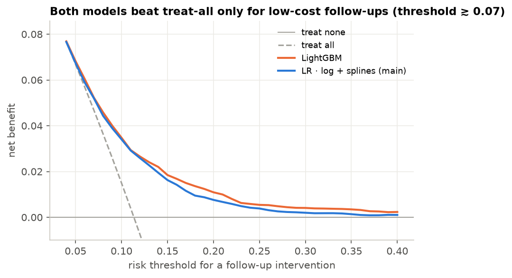
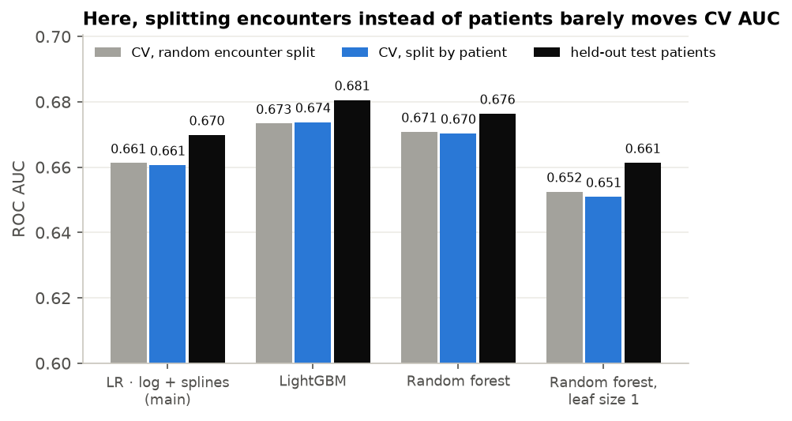
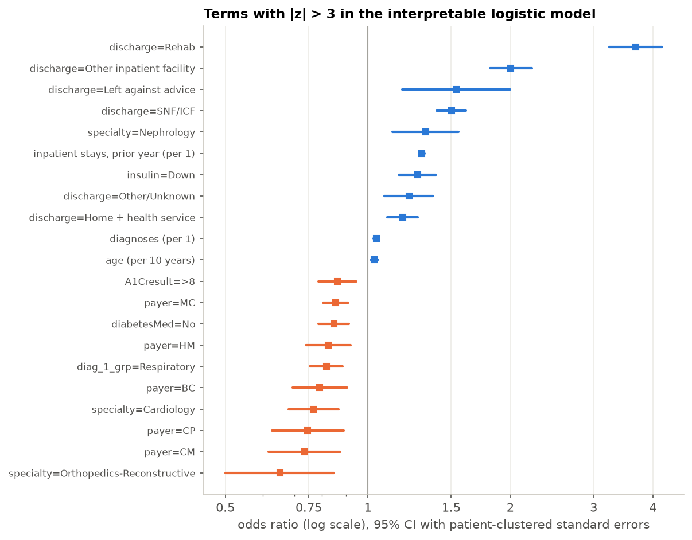

# Diabetes readmission · logistic regression on a messy dataset

**Can a well-specified logistic regression compete with gradient boosting on a famous, irregular clinical
dataset — and what does each metric actually say?**

Predicting **readmission within 30 days** for 99,340 diabetic inpatient encounters from 130 US hospitals
(UCI *Diabetes 130-US Hospitals for Years 1999–2008*, Strack et al., 2014). The target is rare (11.4%),
the signal is weak, 97% of one column is missing, the primary diagnosis has 716 distinct ICD-9 codes and
46% of encounters belong to patients who appear more than once.

- Model on the Hugging Face Hub: **[igorlimamillis/diabetes-readmission-logistic](https://huggingface.co/igorlimamillis/diabetes-readmission-logistic)**
- Write-up (EN/PT): **[igor-millis.github.io/work/diabetes-readmission](https://igor-millis.github.io/work/diabetes-readmission/)**

| | |
|---|---|
| **Main model** | logistic regression · log-counts + cubic B-splines · L2 (C chosen by grouped CV log loss) |
| **Compared with** | 1-feature LR, linear LR, elastic-net LR, class-weighted LR, random forest, LightGBM (30-config random search), + 3 richer LRs |
| **Validation** | 80/20 split **by patient**; 5-fold `StratifiedGroupKFold` inside training; patient-level (cluster) bootstrap, B = 1,000 |
| **Metrics** | 40+ — ranking, proper scores, calibration, 16 confusion-matrix metrics at 4 threshold policies, decision curves |
| **Inference** | logistic GLM fitted with a from-scratch IRLS (NumPy), cluster-robust SEs by patient, checked against statsmodels to 1e-14 |

## Headline results (held-out patients, n = 19,773 encounters)

| model | ROC AUC [95% CI] | PR AUC | Brier | log loss | cal. slope | ECE |
|---|---|---|---|---|---|---|
| prevalence only | 0.500 | 0.114 | 0.1006 | 0.3537 | — | — |
| LR · prior inpatient stays only | 0.611 | 0.184 | 0.0973 | 0.3416 | 1.10 | 0.011 |
| LR · linear terms | 0.670 | 0.222 | 0.0961 | 0.3348 | 1.08 | 0.009 |
| **LR · log + splines (main)** | **0.670 [0.656, 0.683]** | **0.219** | **0.0962** | **0.3347** | **1.04** | **0.007** |
| LR · splines + elastic net | 0.671 | 0.219 | 0.0962 | 0.3345 | 1.04 | 0.008 |
| LR · splines + `class_weight="balanced"` | 0.670 | 0.217 | **0.2254** | **0.6453** | 0.97 | **0.352** |
| Random forest | 0.676 | 0.239 | 0.0953 | 0.3316 | 1.09 | 0.007 |
| LightGBM | **0.681 [0.668, 0.693]** | **0.242** | **0.0950** | **0.3305** | 1.08 | 0.007 |

Paired patient-level bootstrap, LightGBM − main LR: **ΔAUC = +0.011 [+0.006, +0.016]**, ΔPR-AUC = +0.024
[+0.016, +0.034], ΔBrier = −0.0012 [−0.0016, −0.0008]. The difference is real — and small.



### What the comparison says

1. **The logistic model captures ~94% of the achievable lift over chance** (0.170 of the 0.181 AUC points
   LightGBM gets above 0.5), with ~200 coefficients that can be read, audited and shipped as a formula.
2. **Boosting wins only with enough data.** With ≤ 8k training encounters the logistic model has the higher
   test AUC; the trees overtake it around 20k and the gap widens to 0.011 at 80k.

   
3. **Splines did not buy discrimination here** (0.6698 vs 0.6698) **but did buy calibration**: slope 1.04 vs
   1.08, Hosmer–Lemeshow p = 0.077 vs < 0.001, maximum decile error 1.3 vs 2.7 points.
4. **`class_weight="balanced"` is a calibration bug, not an imbalance fix.** Ranking is identical
   (AUC 0.670), but the mean predicted risk jumps from 11% to 47%, Brier more than doubles and ECE goes
   from 0.007 to 0.352. Reweighting only shifts the intercept by log(w₁/w₀); moving the threshold does the
   same job without destroying the probabilities.

   
5. **The 0.5 threshold is meaningless at 11% prevalence.** Calibrated models flag 0.2% of encounters at 0.5:
   accuracy 0.887 (≈ the 0.887 of predicting "no" for everyone), recall 1%, MCC 0.06. The same LR at its
   F1-optimal threshold (0.131, chosen on out-of-fold training predictions): recall 0.475, precision 0.206,
   MCC 0.174.

### Every metric

`results/results.json` holds, for every model, on the test set **and** on out-of-fold training predictions:

- **Ranking (threshold-free):** ROC AUC, Gini, KS, PR AUC (average precision) and its lift over prevalence,
  recall / precision / lift among the top 5, 10, 20 and 30% highest-risk encounters.
- **Probabilistic (proper scores):** Brier, log loss, Brier and log-loss skill vs. the prevalence model,
  discrimination slope (Tjur's R²).
- **Calibration:** calibration intercept and slope, ECE and MCE over risk deciles, observed/expected ratio,
  Spiegelhalter z, Hosmer–Lemeshow χ²(8).
- **At four threshold policies** (F1-optimal, Youden-optimal, top 20%, 0.5 — the first three chosen on
  out-of-fold training predictions, never on the test set): accuracy, balanced accuracy, precision, recall,
  specificity, NPV, F1, F2, F0.5, MCC, Cohen's κ, Youden's J, LR+, LR−, diagnostic odds ratio, flag rate.
- **Uncertainty:** patient-level bootstrap CIs for AUC, PR AUC, Brier and log loss, and paired differences
  of every model against the main LR.
- **Decision curves** (net benefit, Vickers & Elkin 2006) and **subgroup** AUC / calibration-in-the-large by
  age band, sex and race.

At the F1-optimal threshold every model except the one-feature baseline lands in a narrow band — F1 0.279–0.297, MCC 0.163–0.187 — so
threshold metrics are poor at separating models; proper scores and paired bootstrap differences are not.



Net benefit beats "treat all" from a threshold of ~0.05 upward, but shrinks toward zero above ~0.25: the
model is useful for **cheap** follow-ups (a phone call, a pharmacist review), not for expensive interventions.

## Why this dataset is hard — and what was done

| irregularity | evidence | treatment |
|---|---|---|
| rare, weak target | 11.4% readmitted < 30 days; best AUC ≈ 0.68 | proper scores, PR AUC, calibration; thresholds chosen out-of-fold |
| deaths & hospice | 2,423 encounters cannot be readmitted | removed (would teach the model that dying "protects") |
| repeated patients | 69,987 patients, 46% of encounters from repeaters | split, tune and bootstrap **by patient** |
| massive missingness | weight 97%, max_glu_serum 95%, A1C 83%, specialty 49%, payer 40% | weight dropped; "not measured"/"Missing" kept as a level (informative) |
| high-cardinality codes | 716 ICD-9 primary codes, 72 specialties | 9 ICD-9 chapters (Strack et al.); top-12 specialties; rare levels pooled per fold |
| heavy-tailed counts | prior inpatient stays 0–21, ER visits 0–76 | log1p + cubic B-splines inside the pipeline |
| ID codes as numbers | admission / discharge / source are nominal IDs | mapped to clinically meaningful groups |

**Leakage check.** Cross-validating by encounter instead of by patient inflated CV AUC by at most 0.0016,
even for a memorising random forest (leaf size 1). With no patient identifier among the features the models
cannot memorise people, so the grouped split costs nothing here — but it is still the only split whose
estimate answers the deployment question (new patients).



## Closing the gap

Boosting gets two things for free: high-cardinality codes and interactions. Giving them to the logistic
regression explicitly — 3-digit ICD-9 codes (~700 levels, < 100 pooled) and the interactions the trees
suggest (pairwise products of log-counts; prior stays / ER visits × discharge destination and admission
source) — gives (`scripts/close_the_gap.py`, same split, folds and bootstrap resamples):

| model | coefficients | CV log loss | test AUC | Δ AUC vs main LR [95% CI] | Δ AUC vs LightGBM [95% CI] | PR AUC | log loss | cal. slope |
|---|---|---|---|---|---|---|---|---|
| LR · log + splines (main) | 201 | 0.3380 | 0.670 | — | -0.011 | 0.218 | 0.3347 | 1.04 |
| LR · splines + 3-digit ICD-9 | 517 | 0.3373 | 0.673 | +0.003 [+0.000, +0.006] | -0.008 [-0.014, -0.002] | 0.220 | 0.3340 | 1.04 |
| LR · splines + interactions | 251 | 0.3374 | 0.671 | +0.001 [-0.001, +0.004] | -0.010 [-0.014, -0.005] | 0.226 | 0.3336 | 1.03 |
| LR · splines + ICD-9 + interactions | 567 | 0.3367 | 0.674 | +0.004 [+0.001, +0.007] | -0.007 [-0.012, -0.002] | 0.228 | 0.3330 | 1.03 |
| LightGBM | — | 0.3337 | 0.681 | +0.011 | — | 0.242 | 0.3305 | 1.08 |

The richest logistic model closes **about a third of the gap** (+0.004 of 0.011 AUC) and improves PR AUC
and log loss the most, but LightGBM stays significantly ahead. The remaining signal lives in higher-order
interactions that a hand-specified linear predictor does not reach — the honest price of interpretability
on this dataset is ~0.007 AUC.

## Inference: what drives readmission

An interpretable logistic GLM (counts per unit, most frequent level as reference, 68 parameters) fitted on
the training patients with **IRLS written from scratch** (`src/readmission/irls.py`), with **cluster-robust
standard errors by patient** (Liang–Zeger sandwich). Coefficients and clustered SEs match statsmodels to
~1e-14.



- **Prior inpatient stays** dominate: OR 1.30 per stay in the previous year (z = 35.6).
- **Discharge destination** is the second signal: rehab OR 3.7, another inpatient facility 2.0, SNF/ICF 1.5,
  leaving against medical advice 1.5 (vs. home).
- Measured HbA1c > 8 is *protective* (OR 0.86) — consistent with Strack et al.'s finding that measuring HbA1c
  is associated with better follow-up.
- Clustering matters unevenly: the median clustered/model SE ratio is 1.02, but for prior ER visits it is
  1.54 — the patients with many ER visits are the ones who reappear.

Associations, not causal effects.

## Reproduce

```bash
python -m venv .venv && . .venv/bin/activate      # Windows: .venv\Scripts\activate
pip install -r requirements.txt
python scripts/download_data.py                    # UCI zip -> data/raw/
python scripts/run_experiment.py                   # ~45 min on a laptop CPU -> results/, models/
python scripts/close_the_gap.py                    # ~10 min -> results/gap.json
python scripts/make_figures.py                     # -> figures/
pytest -q                                          # 23 tests: ICD-9 grouping, cohort rules, IRLS vs sklearn/statsmodels, metrics
```

```
src/readmission/
  data.py       cohort rules (deaths/hospice removed, target, groups)
  features.py   row-wise feature engineering + per-fold preprocessors (linear / spline / tree / "plus")
  irls.py       logistic IRLS with model, sandwich and cluster-robust covariance
  metrics.py    ranking, proper scores, calibration tests, threshold metrics, decision curves, cluster bootstrap
scripts/        download, experiment, close-the-gap, figures, push to the Hub
tests/          pytest suite
```

## Limitations

- 1999–2008 US data; coding practices (ICD-9) and care pathways have changed. Not for clinical use.
- Readmissions to *other* hospitals are invisible in the source data, so the label under-counts.
- The test AUC is 0.006–0.009 above the CV AUC for every model alike — a property of this particular split; the
  model *ranking* is the same in CV and test.
- Subgroups: AUC is lower for patients aged 70+ (0.63) than for those under 50 (0.71); the
  "race missing" group is small (n = 447) and over-predicted (9.6% predicted vs 7.2% observed).

## Data & license

Data: Strack, B. et al. (2014). *Impact of HbA1c Measurement on Hospital Readmission Rates: Analysis of
70,000 Clinical Database Patient Records.* BioMed Research International. UCI Machine Learning Repository,
[doi:10.24432/C5230J](https://doi.org/10.24432/C5230J), CC BY 4.0 — downloaded at runtime, not redistributed.

Code: MIT © Igor Millis.

---

### Resumo em português

Projeto de Machine Learning sobre **readmissão hospitalar em até 30 dias** de pacientes diabéticos
(99.340 internações, 130 hospitais dos EUA). O dataset é famoso e irregular: alvo raro (11,4%), sinal
fraco, até 97% de ausência numa coluna, 716 códigos CID-9 e pacientes repetidos.

A **regressão logística com splines** foi comparada com floresta aleatória, LightGBM e outras variantes
logísticas em mais de 40 métricas, com validação **por paciente** e bootstrap por paciente. O LightGBM vence
por pouco (ΔAUC = +0,011, IC 95% [0,006; 0,016]). A logística guarda cerca de 94% do ganho, é bem calibrada
(slope 1,04, ECE 0,007), é interpretável (odds ratios com erros-padrão clusterizados, IRLS implementado do
zero) e vence quando há pouco dado. Usar `class_weight="balanced"` mantém a AUC, mas destrói a calibração
(ECE 0,352). Já o limiar 0,5 não serve para nada com prevalência de 11%.
